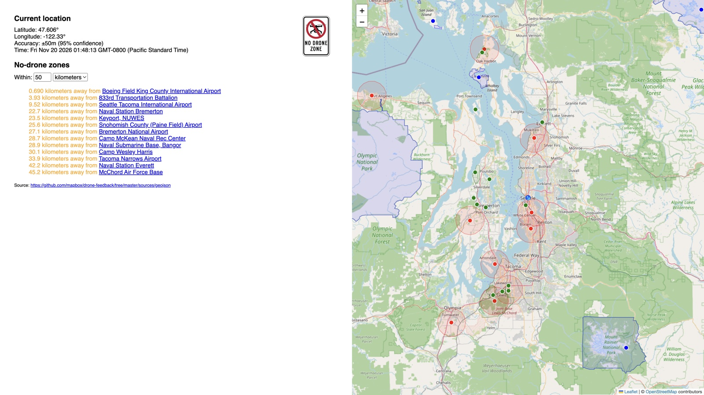

# No-Drone Zones

[](https://github.com/andrewmacheret/no-drone-zones/actions/workflows/deploy.yml) [](https://github.com/andrewmacheret/no-drone-zones/blob/master/LICENSE.md)

Shows the no-drone zones near your current location, on a map and as a list sorted by distance.

Live at [andrewmacheret.com/projects/no-drone-zones](https://andrewmacheret.com/projects/no-drone-zones/).



## Usage

Open the page and allow location access. It covers three kinds of zones in the US:

- Airports, with a 5 mile radius (red pins)
- Military bases (green pins)
- National parks (blue pins)

The list shows every zone within the distance you pick, in kilometers or miles. Orange entries are how far away a zone is. Red entries mean you're inside it, with the distance to its edge. Click a name to show it on the map.

The page downloads all the zone data up front, about 14 MB, so it can take a few seconds to load on a phone.

## How it works

It's a static page in `www/` that uses [jQuery](https://jquery.com/), [Leaflet](https://leafletjs.com/) with [OpenStreetMap](https://www.openstreetmap.org/) tiles for the map, and [Turf.js](https://turfjs.org/) for the distance math. No API keys are needed. The zones are the GeoJSON files from [Mapbox's drone-feedback data](https://github.com/mapbox/drone-feedback/tree/master/sources/geojson), copied into `www/`.

To run it locally:

```
python3 -m http.server -d www
```

Then open [http://localhost:8000](http://localhost:8000). Browsers allow location access on `localhost`, so this works without HTTPS.

## Deploy

Pushes to `master` copy `www/` to `s3://andrewmacheret.com/projects/no-drone-zones` and clear the CloudFront cache through GitHub Actions (see `.github/workflows/deploy.yml`). The workflow signs in to AWS with GitHub OIDC using the IAM role in the `AWS_ROLE_ARN` repo variable.

The workflow gzips the GeoJSON files before uploading them, which cuts the download from 43 MB to about 14 MB. CloudFront won't compress files that big on its own.

`www/screenshot.jpg` is used for this README and for link previews (`og:image`).
